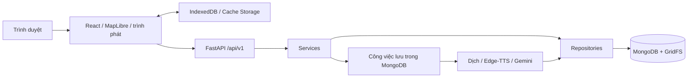

> **Ưu tiên 24/10/2026:** dashboard thống kê Admin và đa ngôn ngữ đã hoàn tất phần demo; QR là bước phát triển kế tiếp. OSM/Stadia và GPS opt-in/mô phỏng/geofence có trong frontend. Nghiệm thu GPS tự phát và ngưỡng thực địa có thể để sau nhưng cần xong trước demo chính thức.

# Kiến trúc

## Trạng thái demo hiện hành — cập nhật 24/10/2026

Khách dùng `#/welcome` không cần tài khoản; bắt đầu hành trình mới mới mở `#/explore`. Browser giữ ID khách và hành trình trong localStorage. Nội dung/audio công khai lấy từ release đã công bố; giao diện và nội dung/audio POI English/Việt theo locale. Visit/journey/audio được ghi qua API sự kiện công khai có schema giới hạn và đếm theo ngày ICT. Admin biên soạn trực tiếp tại `#/admin`, chọn VI/EN/KO để sửa nội dung từng địa điểm và quản lý MP3 tương ứng; xem dashboard/quản lý tài khoản tại `#/management`. Creator workflow/API đã gỡ khỏi demo. Stadia Maps, 10 tọa độ người dùng cung cấp và GPS opt-in/mô phỏng cùng geofence đã tích hợp phía frontend; người dùng đã kiểm chứng tọa độ thực địa và xác nhận chạm điểm phát audio trên điện thoại. Tự phát theo geofence trên iPhone/Safari và ngưỡng GPS chưa nghiệm thu. Dashboard nền hoạt động trên deploy theo xác nhận người dùng. QR là bước phát triển kế tiếp; offline và AI vẫn hoãn. Các phần dài hạn bên dưới vẫn tham khảo kế hoạch gốc.

Trạng thái: phần đầu mô tả demo đang chạy; các mục dài hạn bên dưới là thiết kế mục tiêu.

## Phần demo đã triển khai ngày 22/10/2026

Thanh điều hướng giữa hai trang làm việc dùng chung `shared/WorkspaceNav.tsx`:
`#/admin` hiển thị **Nội dung** (audio), `#/management` hiển thị **Quản trị** (grid).
Hai trang chỉ cho Admin. `features/content/ContentPage.tsx` quản lý POI/văn bản/audio;
`features/admin/ManagementPage.tsx` chỉ đọc dashboard/users và cập nhật user qua API Admin.
Creator UI/API và workflow gửi/duyệt đã gỡ khỏi demo; Admin biên soạn trực tiếp, lưu nháp rồi công bố. Các mô tả Creator bên dưới là lịch sử hoặc kế hoạch dài hạn.
RBAC backend chặn User khỏi cả hai khu vực quản trị.

Router → service → repository vẫn là ranh giới bắt buộc. Demo có một tour `campus-main`:
`tours` lưu bản nháp có thứ tự POI, nội dung tiếng Việt, nguồn và vị trí nullable; chưa tách
`pois`/`localizations` thành collection riêng. `tour_releases` là snapshot insert-only;
tour giữ con trỏ tới release đang công bố. Lưu/công bố/gỡ dùng revision CAS trên document tour.
Nếu có thay đổi đồng thời, trả 409; release tạo trước CAS thất bại không được trỏ tới nên vẫn riêng tư.
Chưa có tác vụ dọn release không tham chiếu; không dùng transaction nhiều document.

`assets` lưu checksum/text checksum/GridFS ID. `audio_selections` chọn asset theo checksum
văn bản cho lần công bố tiếp theo. Snapshot ghim asset ID cụ thể; sửa chữ hoặc nhập MP3 mới
không thay snapshot cũ. API audio chỉ cho nghe qua release đang công bố; biết asset ID không
cho quyền truy cập. Admin có API nghe thử riêng, upload ≤10 MiB và kiểm tra khung MP3.
Trình phát duy nhất được dừng khi đổi địa điểm hoặc rời trang; không tự phát khi tải trang. Khi geofence xác nhận một điểm, ứng dụng thử tự phát audio; nếu trình duyệt chặn thì khách có thể phát thủ công.

Admin API dùng RBAC/CSRF hiện có. Khóa user thu hồi phiên; mở khóa không hồi sinh phiên cũ.
Admin đang hoạt động được bảo vệ khỏi khóa/hạ quyền trên web. Dashboard dùng count database,
snapshot hiện hành và event visit/journey/audio theo ngày. QR, Dịch/TTS tự động, bản đồ,
QR/camera, offline và AI chưa triển khai. GPS tự nhận diện/tự phát theo geofence và ngưỡng thực địa còn chờ nghiệm thu. Các phần dài hạn bên dưới giữ vai trò thiết kế mục tiêu.
P1.1 đã bổ sung connection pool MongoDB theo lifespan và endpoint readiness.
P1.2 có model/repository User/session và unique/TTL index thật trên Atlas.
P1.3 có API JWT cookie/CSRF và dependency RBAC, đã kiểm thử với Atlas thật.
P1.4 có UI auth nội bộ và AuthClient cho khôi phục/gia hạn/đăng xuất.
Explore hiện đọc nội dung công khai đã công bố và phát audio thủ công; vùng sơ đồ là placeholder,
đã tích hợp bản đồ/GPS/geofence trong frontend. Chi tiết giao diện lịch sử tại [báo cáo](test-reports/P1_4_1_EXPLORE_UI.md).
Ưu tiên demo hiện hành ở [DEMO_GUEST_QR_PLAN](DEMO_GUEST_QR_PLAN.md); kế hoạch gốc dài hạn ở bên dưới.

## Thành phần

Frontend và API phục vụ cùng nguồn khi triển khai. Khi phát triển, Vite proxy /api tới FastAPI.
Ứng dụng dùng hash routing (/#/welcome, /#/login, /#/explore, /#/admin, /#/management),
nên tải lại không cần fallback tại server. Nếu đổi sang path routing phải bổ sung fallback giao diện,
không nuốt lỗi 404 của API. UI route guard không thay kiểm tra quyền ở backend.

## Ranh giới mã

- `backend/app/api/v1/endpoints/`: router độc lập auth, content, audio, maps,
  offline_packs, jobs, ai, admin, events. Health và auth có endpoint thực.
- `core/`: cấu hình và chính sách thời hạn phiên; `db/`: Mongo lifecycle và index User/session.
- `commands/`: khởi tạo index tường minh, không tự chạy khi import hoặc startup API.
- `schemas/`, `models/`: hợp đồng HTTP và quy tắc tài liệu lưu trữ.
- `services/`: nghiệp vụ; `repositories/`: truy xuất MongoDB/GridFS.
- `services/providers/`: lớp bọc dịch/TTS/Gemini; `workers/`: xử lý công việc bền vững.
- Frontend chia feature auth, guest, tours, map, playback, offline và admin.
  Vị trí, geofence và audio không được gắn chặt vào một component bản đồ.

## Phiên phía giao diện P1.4

AuthClient chỉ giữ User công khai và mốc hết hạn trong RAM; fetch cùng origin, credentials same-origin,
cache no-store. Không đọc JWT/refresh cookie HttpOnly hoặc lưu token vào Web Storage/IndexedDB.
Bootstrap gọi refresh để khôi phục phiên và lấy mốc hết hạn; 401 là chưa có phiên,
network/503 là lỗi kết nối với nút thử lại. Form đăng ký không tự đăng nhập hoặc cấp role.
Gia hạn trước access expiry 30 giây, chỉ một refresh đang chạy mỗi client;
Web Locks tuần tự hóa login/refresh/logout và CSRF giữa tab trên trình duyệt hỗ trợ.
BroadcastChannel đồng bộ trạng thái đăng nhập/đăng xuất, không truyền token.
Nếu không có Web Locks chỉ bảo đảm chống refresh trùng trong tab; chưa nghiệm thu fallback nhiều tab.
Khi focus/hiện lại trang, GET me kiểm tra phiên/role; GET 401 được refresh và thử lại tối đa một lần.
Chỉ retry POST khi middleware từ chối CSRF rõ ràng; không tự gửi lại login/register vì timeout.
Logout chờ refresh đang gửi, ngăn phản hồi cũ phục hồi trạng thái; lỗi mạng báo chưa đăng xuất thành công.
Tải lại/đóng trang mất RAM là bình thường, cookie phiên cho phép bootstrap lại khi còn hạn.

## Luồng công bố và xử lý nền

Creator tạo nháp, kiểm tra Việt–Anh/MP3 rồi gửi duyệt. Admin duyệt một phiên bản cụ thể.
Service tạo snapshot công bố; chỉnh sửa tiếp theo chỉ đổi nháp, không thay asset của snapshot cũ.

Dịch/TTS lưu job trước, trả mã công việc cho giao diện. Worker có retry hữu hạn,
lease/khôi phục công việc dang dở, giới hạn đồng thời và chống trùng theo phiên bản nội dung.
Không dùng tác vụ chỉ nằm trong RAM làm nguồn trạng thái duy nhất. Khi kết quả trả về,
kiểm tra phiên bản đầu vào để không gắn âm thanh cũ vào nội dung mới.
Chi tiết thời gian lease/retry sẽ được chốt và kiểm thử khi triển khai worker.

## Bảo mật và lưu trữ

JWT HttpOnly cookie, Secure trên HTTPS, kiểm tra CSRF và RBAC ở backend.
P1.3 đặt Secure khi ENVIRONMENT=production (phải phục vụ qua HTTPS),
SameSite=Lax, host-only, path /api/v1. Không trả access/refresh token trong JSON.
CSRF ký HMAC, cookie HttpOnly + token JSON để gửi X-CSRF-Token; gắn session ID sau login.
Middleware kiểm tra mọi API unsafe, Origin theo allowlist và Sec-Fetch-Site.
Argon2 chạy trong threadpool; phản hồi validation bỏ input để không phản chiếu mật khẩu.
Mỗi request xác thực tra phiên còn hiệu lực và User còn hoạt động; role lấy từ database.
API auth trả no-store; secret thiếu thì 503, không dùng khóa mặc định.
RBAC là dependency dùng chung; API và màn hình quản trị nội dung/tài khoản đã triển khai trong demo. Chi tiết theo hợp đồng hiện hành ở [DATA_AND_API](DATA_AND_API.md).
Chính sách đã chốt: access token 15 phút, tự gia hạn trong phiên tối đa 7 ngày tuyệt đối.
Session lưu digest refresh token, thay digest bằng cập nhật nguyên tử; không kéo dài expires_at.
TTL chỉ dọn dữ liệu cũ, repository luôn kiểm tra thời hạn/thu hồi khi truy vấn phiên.
Đăng ký không nhận quyền từ client. Xác thực, token và phản hồi quản trị không được cache
bằng chiến lược API chung của service worker. Không đưa bí mật Gemini/TTS vào frontend.

MongoDB lưu metadata; GridFS lưu file. API media kiểm tra quyền và hỗ trợ Range.
Bản đồ phải có đủ style/font/sprite được phép đóng gói; PMTiles không tự bao gồm các phụ thuộc này.
Offline pack được chọn theo release/ngôn ngữ; bản đồ/ảnh dùng chung qua tham chiếu asset/checksum,
nội dung/MP3 theo ngôn ngữ. Không bắt tải mọi ngôn ngữ trên server. Xem [runtime](TOUR_RUNTIME.md).

## Triển khai

Mục tiêu: Render phục vụ frontend/API và Atlas Free lưu dữ liệu. Không lưu tài nguyên cần tồn tại
lâu dài trên filesystem tạm của Render.
Docker Compose là bản dự phòng FastAPI + MongoDB có volume; dùng HTTPS khi thử GPS trên điện thoại.
Hiện có cấu hình Docker nhưng chưa chạy xác minh trong repository. Ứng dụng đã từng được triển khai lên Render; dashboard đã hoạt động theo xác nhận người dùng. Tại lần cập nhật 24/10, Render báo service “Suspended by you”, nên thay đổi code mới trong workspace chưa deploy lên đó. Atlas đã được kiểm thử; xem [hướng dẫn deploy](DEPLOY_RENDER.md).

## Kết nối dữ liệu P1.1

Mỗi lifespan có một AsyncMongoClient, được đóng khi ứng dụng dừng, không tạo client mỗi request.
Factory ở app/application.py không đọc môi trường khi import; app/main.py là entrypoint
khởi tạo ứng dụng từ cấu hình. Test dùng factory với Settings riêng.
Không thực hiện I/O mạng khi import module. Chưa cấu hình URI thì không cấp pool.
Readiness ping database với thời gian chờ hữu hạn, trả connected/not_configured/unavailable;
liveness độc lập để không nhầm lỗi MongoDB với tiến trình đã dừng.
Pool dùng datetime có múi giờ. URI là SecretStr, bị loại khỏi dump/repr cấu hình;
phản hồi readiness không chứa lỗi driver/host/credential. Chưa có thao tác ghi dữ liệu ở P1.1.
