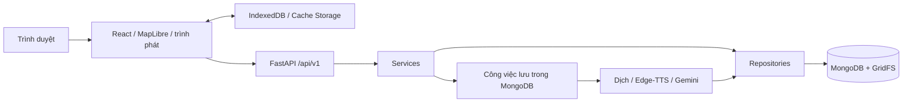

# Kiến trúc

Trạng thái: **thiết kế mục tiêu**; xem README để phân biệt phần đã chạy.

## Thành phần

Frontend và API phục vụ cùng nguồn khi triển khai. Khi phát triển, Vite proxy /api tới FastAPI.
Đường dẫn tĩnh trong FastAPI hiện chỉ phục vụ trang mở đầu; khi thêm client-side routing
phải bổ sung fallback cho đường dẫn giao diện, không nuốt lỗi 404 của API.

## Ranh giới mã

- `backend/app/api/v1/endpoints/`: router độc lập auth, content, audio, maps,
  offline_packs, jobs, ai, admin, events. Chỉ health có endpoint thực.
- `core/`: cấu hình và các phụ thuộc bảo mật sau này; `db/`: vòng đời Mongo client/index.
- `schemas/`, `models/`: hợp đồng HTTP và quy tắc tài liệu lưu trữ.
- `services/`: nghiệp vụ; `repositories/`: truy xuất MongoDB/GridFS.
- `services/providers/`: lớp bọc dịch/TTS/Gemini; `workers/`: xử lý công việc bền vững.
- Frontend chia feature auth, tours, map, playback, offline, creator và admin.
  Vị trí, geofence và audio không được gắn chặt vào một component bản đồ.

## Luồng công bố và xử lý nền

Creator tạo nháp, kiểm tra Việt–Anh/MP3 rồi gửi duyệt. Admin duyệt một phiên bản cụ thể.
Service tạo snapshot công bố; chỉnh sửa tiếp theo chỉ đổi nháp, không thay asset của snapshot cũ.

Dịch/TTS lưu job trước, trả mã công việc cho giao diện. Worker có retry hữu hạn,
lease/khôi phục công việc dang dở, giới hạn đồng thời và chống trùng theo phiên bản nội dung.
Không dùng tác vụ chỉ nằm trong RAM làm nguồn trạng thái duy nhất. Khi kết quả trả về,
kiểm tra phiên bản đầu vào để không gắn âm thanh cũ vào nội dung mới.
Chi tiết thời gian lease/retry sẽ được chốt và kiểm thử khi triển khai worker.

## Bảo mật và lưu trữ

JWT HttpOnly cookie, Secure trên HTTPS, kiểm tra CSRF và RBAC ở backend.
Đăng ký không nhận quyền từ client. Xác thực, token và phản hồi quản trị không được cache
bằng chiến lược API chung của service worker. Không đưa bí mật Gemini/TTS vào frontend.

MongoDB lưu metadata; GridFS lưu file. API media kiểm tra quyền và hỗ trợ Range.
Bản đồ phải có đủ style/font/sprite được phép đóng gói; PMTiles không tự bao gồm các phụ thuộc này.

## Triển khai

Mục tiêu: Render phục vụ frontend/API và Atlas Free lưu dữ liệu. Không lưu tài nguyên cần tồn tại
lâu dài trên filesystem tạm của Render.
Docker Compose là bản dự phòng FastAPI + MongoDB có volume; dùng HTTPS khi thử GPS trên điện thoại.
Hiện có cấu hình Docker nhưng chưa chạy xác minh, chưa có cấu hình cloud hoặc cơ sở dữ liệu thật.
