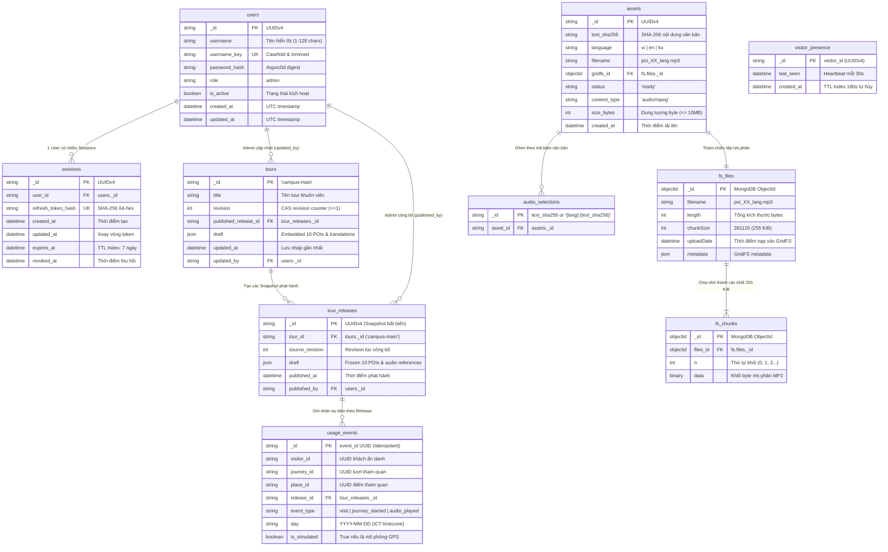
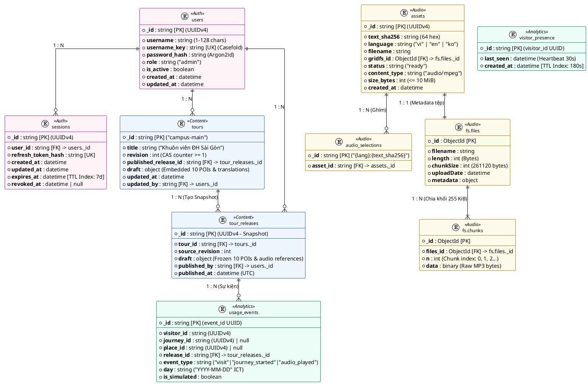

# SƠ ĐỒ QUAN HỆ THỰC THỂ (ENTITY RELATIONSHIP DIAGRAM - ERD)
## ĐỒNG BỘ 100% VỚI CƠ SỞ DỮ LIỆU MONGODB ATLAS THỰC TẾ (10 COLLECTIONS)
**Dự án:** Website Thuyết Minh Tự Động Khuôn Viên Đại Học Sài Gòn (SGU Campus Guide)

---

## 1. ĐỐI CHIẾU VỚI CSDL MONGODB ATLAS THỰC TẾ

Sơ đồ ERD này được đồng bộ chuẩn xác **100% với 10 Collections thực tế** đang hoạt động trên cụm MongoDB Atlas (khớp hoàn toàn với ảnh chụp giao diện quản lý database):

| STT | Tên Collection trong MongoDB Atlas | Số lượng Documents (Thực tế) | Dung lượng dữ liệu | Vai trò trong hệ thống |
| :---: | :--- | :---: | :---: | :--- |
| **1** | **`assets`** | 30 docs | 45.06 kB | Metadata 30 tệp âm thanh MP3 (10 POI $\times$ 3 ngôn ngữ: VI, EN, KO). |
| **2** | **`audio_selections`** | 30 docs | 45.06 kB | Bảng ghim liên kết giữa mã băm văn bản thuyết minh và `asset_id`. |
| **3** | **`fs.chunks`** | 30 docs | 5.46 MB | GridFS Binary Chunks: Lưu trữ dữ liệu nhị phân thô của file MP3 (255 KiB/chunk). |
| **4** | **`fs.files`** | 30 docs | 36.86 kB | GridFS Files: Lưu metadata tệp nhị phân âm thanh trong Bucket. |
| **5** | **`sessions`** | 4 docs | 36.86 kB | Quản lý phiên làm việc của Admin, lưu hash của Refresh Token (hạn 7 ngày). |
| **6** | **`tour_releases`** | 13 docs | 180.22 kB | Các bản phát hành Snapshot bất biến (`release_id = UUIDv4()`). Khách chỉ đọc từ đây. |
| **7** | **`tours`** | 1 doc | 53.25 kB | Bản nháp tour khuôn viên (`_id: "campus-main"`, nhúng 10 POIs, revision CAS). |
| **8** | **`usage_events`** | 277 docs | 77.82 kB | Nhật ký sự kiện khách tham quan (`visit`, `journey_started`, `audio_played`). |
| **9** | **`users`** | 1 doc | 36.86 kB | Tài khoản Quản trị viên duy nhất (`phong`, mật khẩu băm Argon2id). |
| **10** | **`visitor_presence`** | 16 docs | 36.86 kB | Tín hiệu sống heartbeat (30s) của khách online; có TTL Index 180s tự hủy. |

> 📌 **Ghi chú kỹ thuật về 10 địa điểm (POIs):**  
> Trong MongoDB Atlas thực tế, **không có collection riêng `pois` hay `localizations`**. Toàn bộ 10 điểm tham quan, tọa độ GeoJSON `Point [lng, lat]`, bán kính geofence và các bản dịch tiếng Anh/Hàn được lưu trữ theo mẫu **Embedded Document Pattern (Tài liệu nhúng lồng)** trực tiếp trong mảng `draft.places` của `tours` và `tour_releases`. Điều này giúp tối ưu hóa hiệu năng: đọc toàn bộ tour chỉ với **1 query duy nhất** (`find_one`).

---

## 2. SƠ ĐỒ ERD TỔNG QUAN (MERMAID ER DIAGRAM)

---

## 3. MÃ PLANTUML CROW'S FOOT (ĐÚNG 10 THỰC THỂ)

Mã PlantUML dưới đây sẵn sàng để dán trực tiếp vào Draw.io (Menu: **`+` (Insert)** $\rightarrow$ **Advanced** $\rightarrow$ **PlantUML**):

---

## 4. TỪ ĐIỂN DỮ LIỆU CHI TIẾT 10 COLLECTIONS

### 1. `users` (Tài khoản Quản trị)
- `_id`: String (UUIDv4) - Khóa chính.
- `username`: String (1-128 ký tự, tên hiển thị).
- `username_key`: String (casefold + trim, Unique Index: `uq_users_username_key`).
- `password_hash`: String (Mã băm Argon2id).
- `role`: String (`"admin"`).
- `is_active`: Boolean (Mặc định `true`).
- `created_at`: DateTime (UTC Milliseconds).
- `updated_at`: DateTime (UTC Milliseconds).

### 2. `sessions` (Phiên đăng nhập Admin)
- `_id`: String (UUIDv4) - Khóa chính.
- `user_id`: String (FK $\rightarrow$ `users._id`).
- `refresh_token_hash`: String (SHA-256 64 hex, Unique Index: `uq_sessions_refresh_token_hash`).
- `created_at`: DateTime.
- `updated_at`: DateTime.
- `expires_at`: DateTime (TTL Index `ttl_sessions_expires_at`: tự xóa sau 7 ngày).
- `revoked_at`: DateTime | Null (mốc thu hồi khi đăng xuất).

### 3. `tours` (Bản nháp Tour khuôn viên)
- `_id`: String (`"campus-main"`) - Khóa chính.
- `title`: String ("Khuôn viên ĐH Sài Gòn").
- `revision`: Integer (CAS Optimistic Concurrency Control, bắt đầu từ 1).
- `published_release_id`: String | Null (FK $\rightarrow$ `tour_releases._id`).
- `draft`: Object chứa:
  - `language`: `"vi"`.
  - `places`: Mảng lồng 10 POIs (mỗi điểm có `id`, `title`, `description`, `source`, `location: Point[lng, lat]`, `translations: {en, ko}`).
- `updated_at`: DateTime.
- `updated_by`: String (FK $\rightarrow$ `users._id`).

### 4. `tour_releases` (Bản công bố Snapshot bất biến)
- `_id`: String (UUIDv4) - Khóa chính.
- `tour_id`: String (`"campus-main"`, FK $\rightarrow$ `tours._id`).
- `source_revision`: Integer (Revision tại thời điểm công bố).
- `draft`: Object (Snapshot đông cứng nội dung 10 POIs và audio ghim).
- `published_by`: String (FK $\rightarrow$ `users._id`).
- `published_at`: DateTime (UTC).

### 5. `audio_selections` (Ghim tệp Audio theo mã băm văn bản)
- `_id`: String (`text_sha256` hoặc `{lang}:{text_sha256}`) - Khóa chính.
- `asset_id`: String (FK $\rightarrow$ `assets._id`).

### 6. `assets` (Metadata tài nguyên âm thanh MP3)
- `_id`: String (UUIDv4) - Khóa chính.
- `text_sha256`: String (64 hex characters).
- `language`: String (`"vi"`, `"en"`, `"ko"`).
- `filename`: String (ví dụ: `poi_01_vi.mp3`).
- `gridfs_id`: ObjectId (FK $\rightarrow$ `fs.files._id`).
- `status`: String (`"ready"`).
- `content_type`: String (`"audio/mpeg"`).
- `size_bytes`: Integer ($\le 10\text{ MiB}$).
- `created_at`: DateTime.

### 7. `fs.files` (GridFS Files Metadata)
- `_id`: ObjectId - Khóa chính.
- `filename`: String.
- `length`: Integer (Tổng số byte).
- `chunkSize`: Integer (261,120 bytes = 255 KiB).
- `uploadDate`: DateTime.
- `metadata`: Document.

### 8. `fs.chunks` (GridFS Binary Chunks)
- `_id`: ObjectId - Khóa chính.
- `files_id`: ObjectId (FK $\rightarrow$ `fs.files._id`).
- `n`: Integer (Thứ tự khối: 0, 1, 2...).
- `data`: Binary (Dữ liệu byte nhị phân của chunk).

### 9. `usage_events` (Nhật ký sự kiện khách tham quan)
- `_id`: String (UUIDv4 - `event_id` chống gửi trùng) - Khóa chính.
- `visitor_id`: String (UUIDv4).
- `journey_id`: String (UUIDv4) | Null.
- `place_id`: String (UUIDv4) | Null.
- `release_id`: String (UUIDv4) | Null (FK $\rightarrow$ `tour_releases._id`).
- `event_type`: String (`"visit"`, `"journey_started"`, `"audio_played"`).
- `day`: String (`"YYYY-MM-DD"` theo giờ ICT).
- `is_simulated`: Boolean (`true` nếu bật mô phỏng GPS, `false` nếu khách thật).

### 10. `visitor_presence` (Tín hiệu sống của khách online)
- `_id`: String (`visitor_id` UUID) - Khóa chính.
- `last_seen`: DateTime (Cập nhật mỗi 30s qua heartbeat).
- `created_at`: DateTime (TTL Index `ttl_visitor_presence_last_seen`: tự động xóa sau 180s).
