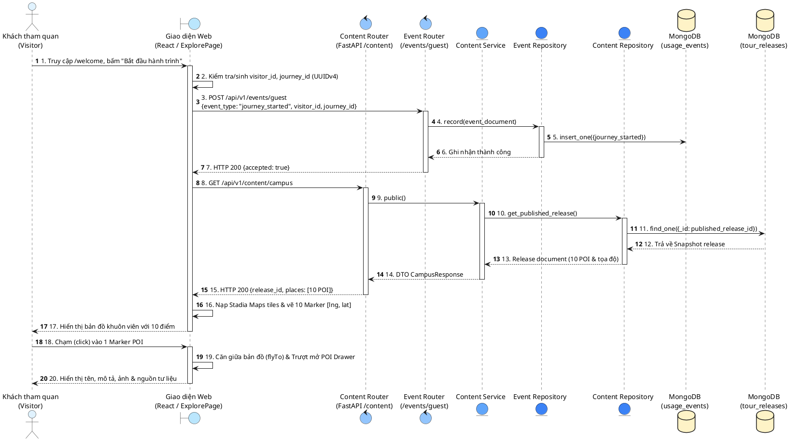
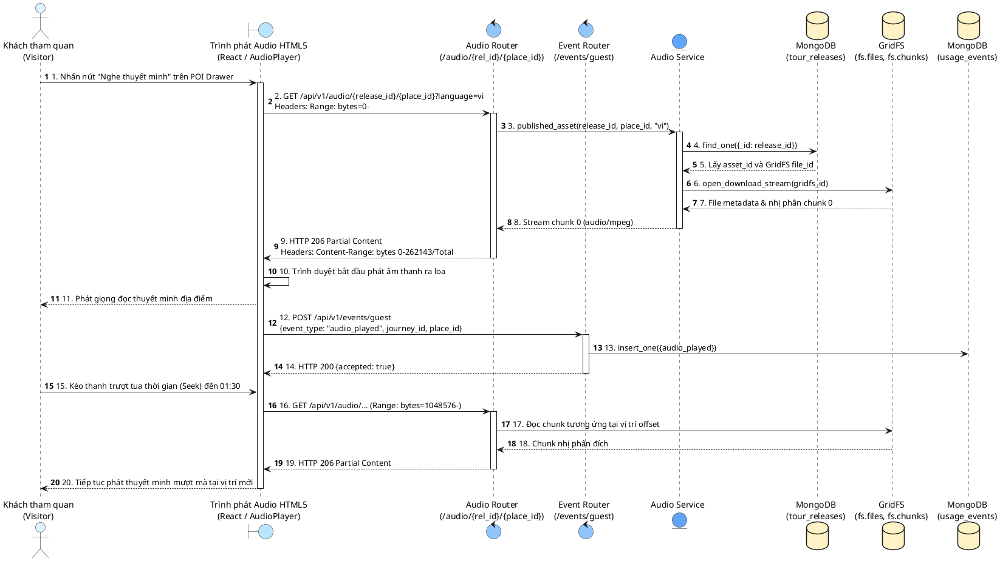
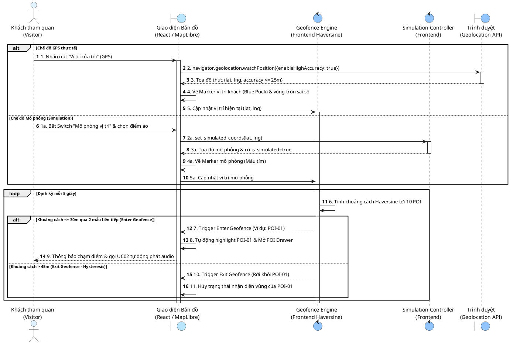
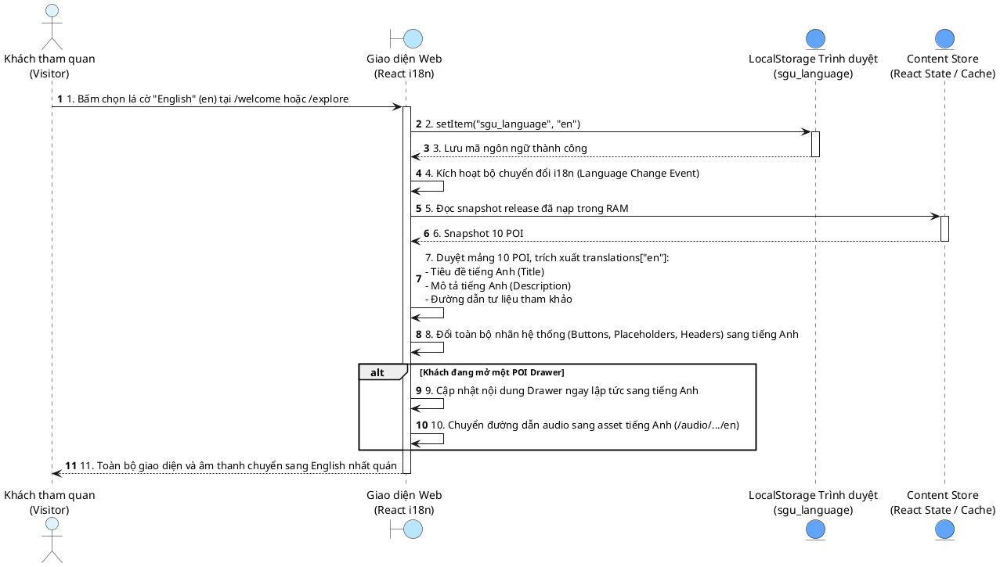
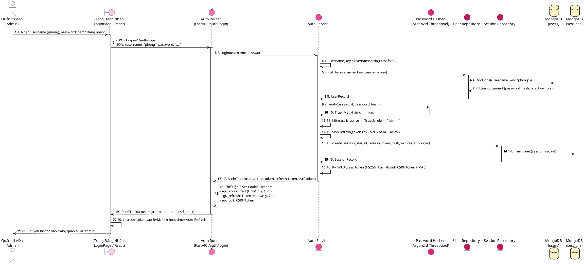
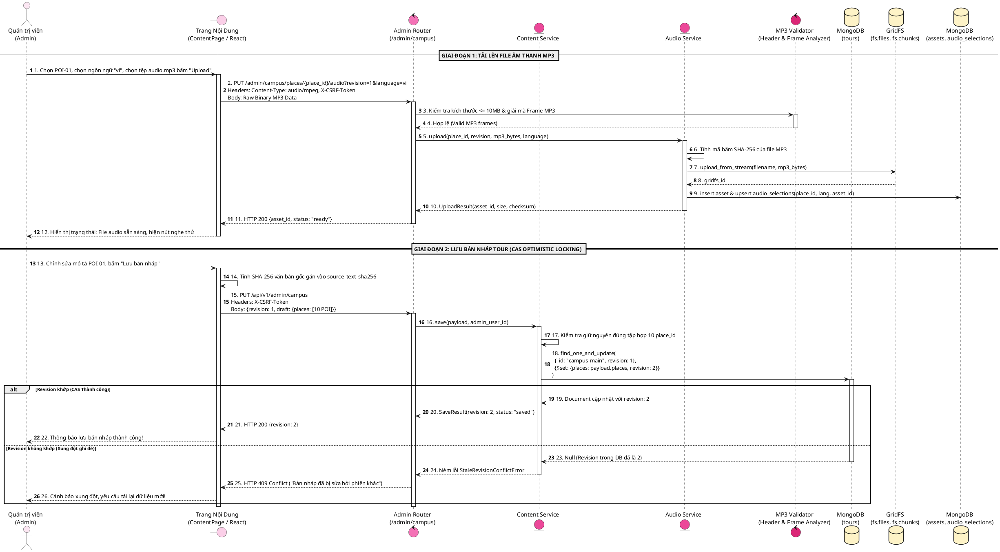
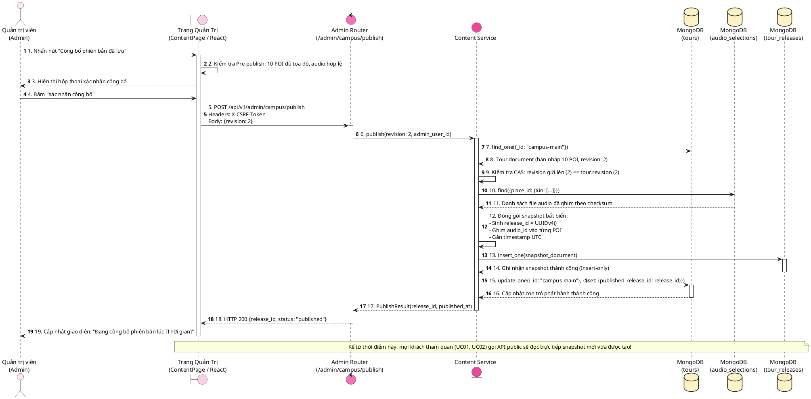
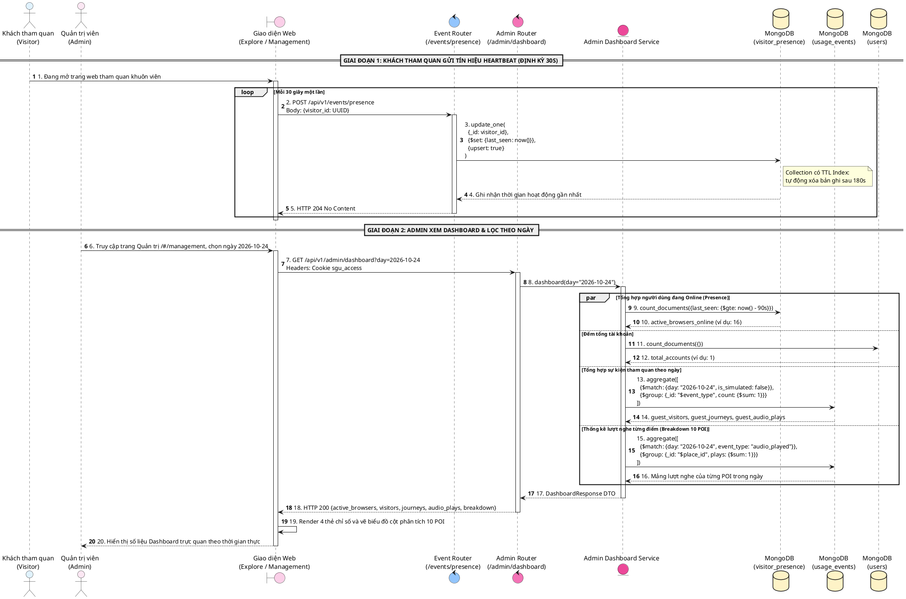

# TỔNG HỢP 8 BIỂU ĐỒ TUẦN TỰ (UML SEQUENCE DIAGRAMS)
## HỆ THỐNG WEBSITE THUYẾT MINH TỰ ĐỘNG KHUÔN VIÊN ĐẠI HỌC SÀI GÒN

Hệ thống được thiết kế theo kiến trúc chuẩn (**Client -> API Router -> Service Layer -> Repository Layer -> MongoDB/GridFS Storage**).
Dưới đây là **8 biểu đồ tuần tự độc lập (SQ01 đến SQ08)** tương ứng 1 - 1 với **8 Use Case cốt lõi (UC01 đến UC08)** và **8 tiến trình DFD Mức 1 (P1.0 đến P8.0)**.

---

### SQ01: BIỂU ĐỒ TUẦN TỰ CHO UC01 — KHÁM PHÁ KHUÔN VIÊN QUA BẢN ĐỒ
*Tương ứng: DFD Tiến trình 2.0 (Khám phá khuôn viên qua bản đồ)*

---

### SQ02: BIỂU ĐỒ TUẦN TỰ CHO UC02 — NGHE THUYẾT MINH AUDIO
*Tương ứng: DFD Tiến trình 4.0 (Nghe thuyết minh audio)*

---

### SQ03: BIỂU ĐỒ TUẦN TỰ CHO UC03 — ĐỊNH VỊ GPS VÀ MÔ PHỎNG VỊ TRÍ
*Tương ứng: DFD Tiến trình 3.0 (Định vị GPS & Mô phỏng vị trí)*

---

### SQ04: BIỂU ĐỒ TUẦN TỰ CHO UC04 — LỰA CHỌN NGÔN NGỮ
*Tương ứng: DFD Tiến trình 1.0 (Lựa chọn ngôn ngữ)*

---

### SQ05: BIỂU ĐỒ TUẦN TỰ CHO UC05 — ĐĂNG NHẬP HỆ THỐNG
*Tương ứng: DFD Tiến trình 5.0 (Đăng nhập hệ thống)*

---

### SQ06: BIỂU ĐỒ TUẦN TỰ CHO UC06 — BIÊN TẬP NỘI DUNG VÀ AUDIO ĐỊA ĐIỂM
*Tương ứng: DFD Tiến trình 6.0 (Biên tập nội dung & audio địa điểm)*

---

### SQ07: BIỂU ĐỒ TUẦN TỰ CHO UC07 — QUẢN LÝ CÔNG BỐ BẢN THUYẾT MINH
*Tương ứng: DFD Tiến trình 7.0 (Quản lý công bố bản thuyết minh)*

---

### SQ08: BIỂU ĐỒ TUẦN TỰ CHO UC08 — XEM THỐNG KÊ BÁO CÁO DASHBOARD
*Tương ứng: DFD Tiến trình 8.0 (Xem thống kê báo cáo)*

